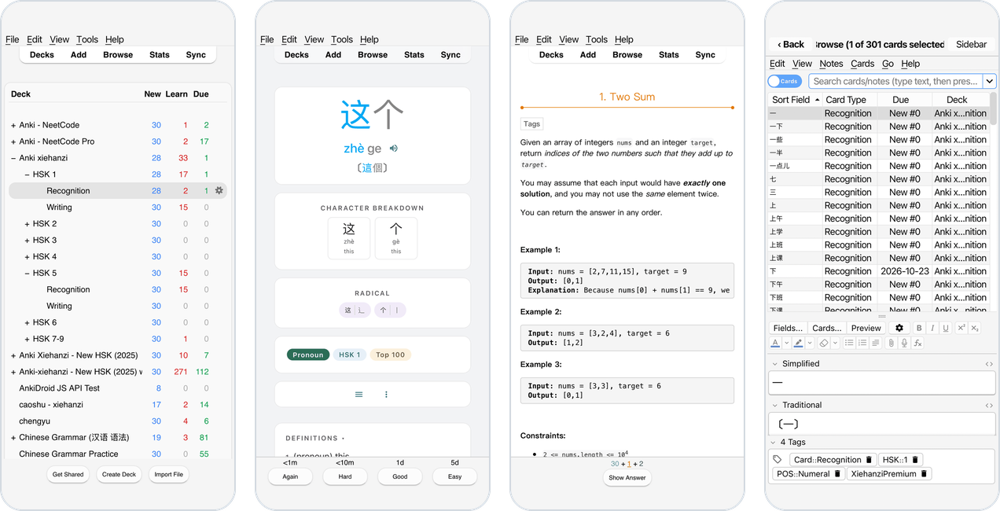
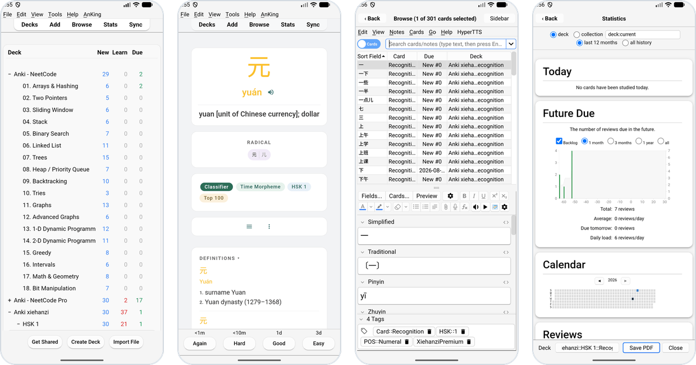

  

<h1 align="center">Kioku</h1>

  <b>The real Anki desktop app on your phone.</b> 
  Add-ons, the card browser and every desktop feature, made for a touch screen.

  

  
  
  
  
  

---

AnkiDroid and AnkiMobile are great, but some things exist only in Anki
desktop: add-ons, and the desktop's own card browser, editors and tools.
Kioku runs the **unmodified Anki desktop app** (`aqt`, Qt 6) on phones, with
your decks, add-ons and settings kept on the device. (Kioku, 記憶, is Japanese
for "memory".)

It comes in three variants, each built a different way.

## iPhone and iPad

Anki compiled into a normal iOS app: embedded Python, Qt and PyQt6, with the
system web view (WKWebView) in place of Qt WebEngine. Every window opens full
screen; your collection is in the Files app.

  

## Android: native variant

The same native build for Android, with Android's WebView. Every window
opens full screen, the Back key closes it.

  

## Android: Termux variant

A small Linux desktop inside the APK, with Anki open: Termux packages, an X11
display and a window manager. Anki runs with Qt WebEngine exactly as on a
Linux PC, and other Linux apps install on demand.

  

More screenshots: [docs/screenshots.md](docs/screenshots.md).

## Which one?

| | iPhone, iPad | Android, native | Android, Termux |
| --- | --- | --- | --- |
| **Needs** | iOS 17+ | Android 9+, arm64 | Android 7+, arm64, ~1 GB free, 3 GB+ RAM recommended |
| **Download** | ~42 MB IPA | ~50 MB APK | ~245 MB APK |
| **How Anki runs** | Python 3.14, Qt 6.11 and PyQt6 compiled into the app | Python 3.14, Qt 6.11 and PyQt6 compiled into the app | Termux userland, termux-x11 display, JWM window manager |
| **Web pages** (cards, stats, editor) | WKWebView | Android System WebView | Qt WebEngine (Chromium), as on the desktop |
| **Windows** | Full screen, ‹ Back closes, popups as cards above the keyboard | Full screen, Back key closes, popups as cards above the keyboard | Desktop windows, a dock, touch or mouse pad mode |
| **Add-ons** | Yes; 15 tested. No subprocesses (MeCab readings in Japanese Support) | Yes; 15 popular ones tested | Yes, as on Linux |
| **Card audio** | mp3; ogg/opus not yet | mp3, wav, ogg, opus | Not tested |
| **Statistics: Save PDF** | Not yet | Yes | Not tested |
| **AnkiWeb sync** | Not tested yet | Yes, media too; login kept across restarts | Yes |
| **Your files** | Files app → Kioku (Anki2/, Exports/) | `Android/data/io.ankidesk.kioku/files` (Import/, Exports/) | Import from Downloads, share decks to Kioku, link phone folders |
| **Other Linux apps** | No | No | Yes: file manager, terminal, web browser… from Termux |
| **Install** | AltStore source, or sideload the unsigned IPA | APK from Releases | APK from Releases |
| **Pick it if** | You have an iPhone or iPad | You want a light, fast app that feels native | You want the full desktop, Linux tools and every add-on |

Test results per area and add-on: [docs/testing.md](docs/testing.md).

## Features

All variants:

- **Anki desktop, unmodified.** Anki 26.08.1's own Python code and Rust core:
  the deck list, reviewer, Browse, the editor, image occlusion, the new
  statistics page, deck options, filtered decks, note types, import and export.
- **Desktop add-ons.** Install them from AnkiWeb inside the app with their
  codes. AnkiConnect, Review Heatmap, HyperTTS, Advanced Browser and others
  are tested.
- **Made for touch.** Big type and buttons, drag to scroll, the keyboard opens
  when a text field is tapped, windows fit the phone in portrait and landscape.
- **Your data stays on the phone.** Collections, media and add-ons survive app
  updates. Move them with AnkiWeb sync or an exported `.colpkg`.

Native variants only:

- **Small and fast to start**: no Linux userland, a fraction of the size.
- **Phone-sized popups**: login, prompts and message boxes are cards that
  stay above the keyboard.
- **System web view**: debuggable with Safari's Web Inspector (iOS) or
  `chrome://inspect` (Android).

Termux variant only:

- **A tiny phone desktop**: app launcher with search, a dock with open windows,
  wallpapers, a Kioku button that hides all windows.
- **Linux apps on demand** from the Termux repositories.
- **Recovers by itself**: Retry, Safe mode (no add-ons), Repair runtime (decks
  kept) or Share log when start-up fails.

## Install

All downloads are on the **[latest release](https://github.com/krmanik/kioku/releases/latest)**.

**iPhone, iPad:** in [AltStore](https://altstore.io), add the source
`https://github.com/krmanik/kioku/releases/latest/download/altstore.json`
(Sources → +) and install Kioku. Or sideload
`Kioku-iOS-<version>-unsigned.ipa` with any tool that signs apps with your
Apple ID (Sideloadly, …).

**Android, native:** download `Kioku-Android-<version>-arm64.apk`, open it and
allow installing from your browser or file manager.

**Android, Termux:** download `Kioku-Termux-<version>-arm64.apk` and install it
the same way. The first start unpacks the runtime, about a minute. Both
Android variants can be installed side by side.

**Moving your collection:** sync with AnkiWeb (Sync in the top bar), or export
a `.colpkg` from Anki on your computer and import it in Kioku.

## Repository

| Folder | What's in it |
| --- | --- |
| [`ios/`](ios/) | The iOS variant: Xcode build, WKWebView layer ([README](ios/README.md)) |
| [`android/`](android/) | The native Android variant: CMake/Gradle build, Android web view, Qt patches |
| [`termux/`](termux/) | The Termux variant: Android app, desktop shell, runtime build ([README](termux/README.md)) |
| [`shared/`](shared/) | What the native variants share: the Python layer (`shared/python/kioku/`), versions, icon and build tools |
| [`docs/`](docs/) | [Fixes log](docs/fixes.md), [test results](docs/testing.md), [screenshots](docs/screenshots.md) |

Building:

- iOS: `cd ios && tools/build.sh`, see [ios/README.md](ios/README.md)
- Native Android: `cd android && tools/build.sh` (Android SDK, NDK, uv, rustup)
- Termux: [termux/docs/building.md](termux/docs/building.md)

GitHub Actions build every variant on a `v*` tag and attach it to the release;
another workflow checks daily for a new Anki release.

## Credits

Kioku stands on [Anki](https://apps.ankiweb.net), [Qt](https://www.qt.io) and
[PyQt](https://riverbankcomputing.com/software/pyqt/),
[BeeWare's Python builds](https://github.com/beeware/Python-Apple-support) and
[rubicon-objc](https://github.com/beeware/rubicon-objc),
[Termux](https://termux.dev) and its packages,
[Termux:X11](https://github.com/termux/termux-x11) and
[JWM](https://joewing.net/projects/jwm/). Anki is AGPL-3.0; see
[termux/docs/distribution.md](termux/docs/distribution.md) for the other
licenses.

"Anki" is a trademark of Ankitects. Kioku is an independent project, not
affiliated with or endorsed by Ankitects.
