

  

<h1 align="center">Kioku</h1>

  <b>The real Anki desktop app on your phone.</b> 
  Add-ons, the card browser and every desktop feature, made for a touch screen.

---

Kioku runs the unmodified Anki desktop app (`aqt`, Qt 6) on phones. Each folder
is a separate app built a different way:

| Folder | Platform | How it runs Anki |
| --- | --- | --- |
| [`termux/`](termux/) | Android | Termux packages and a small X11 desktop inside the APK; installs other Linux apps on demand. |
| [`ios/`](ios/) | iPhone, iPad | Natively: embedded Python, Qt and PyQt6 compiled into the app, the system web view in place of Qt WebEngine. |
| [`android/`](android/) | Android 9+ (arm64) | Natively, the same way as `ios/`, with Android's WebView. |

[`shared/`](shared/) holds the Python layer and versions the native variants
have in common; [`docs/`](docs/) has the [fixes log](docs/fixes.md) and
[test results](docs/testing.md).

## Screenshots

Deck list, reviewing (question and answer), Browse, Statistics and Add.

Android:

  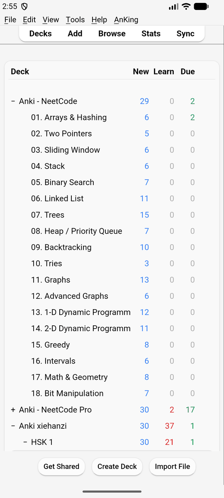
  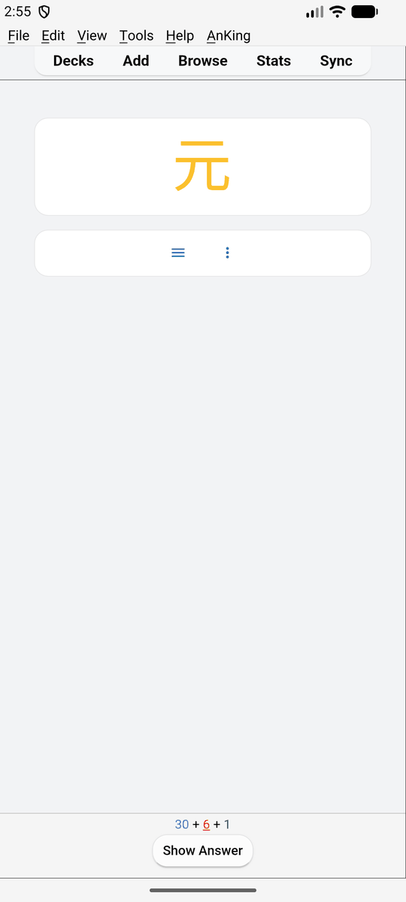
  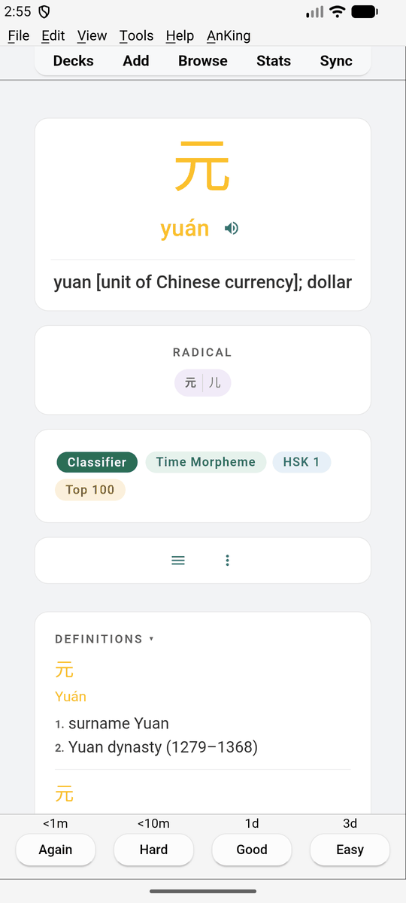
  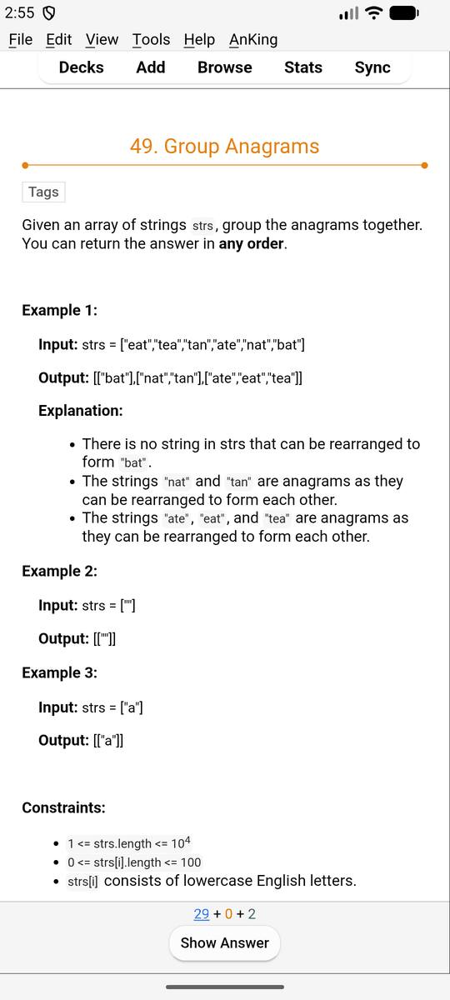
  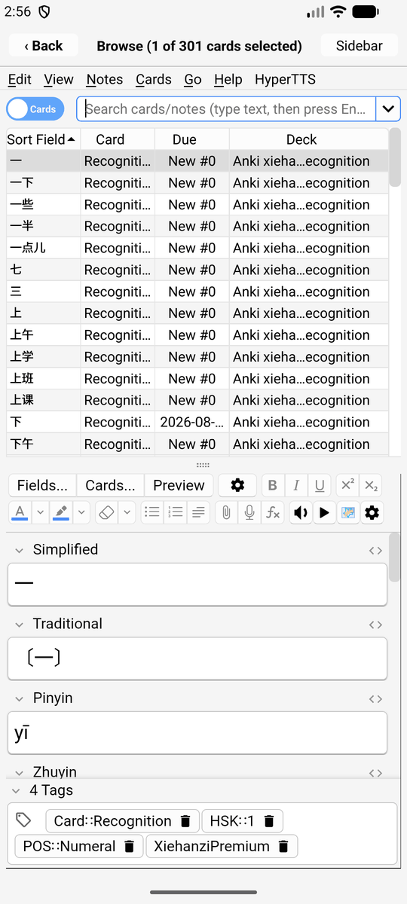
  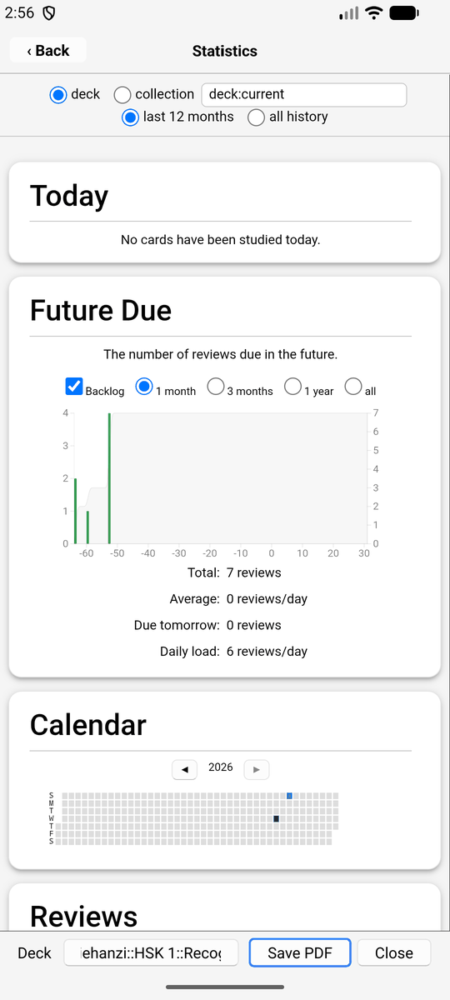
  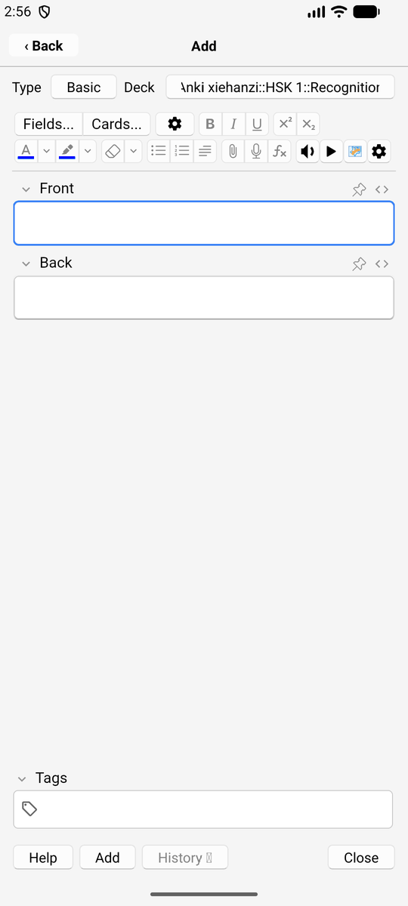

iPhone:

  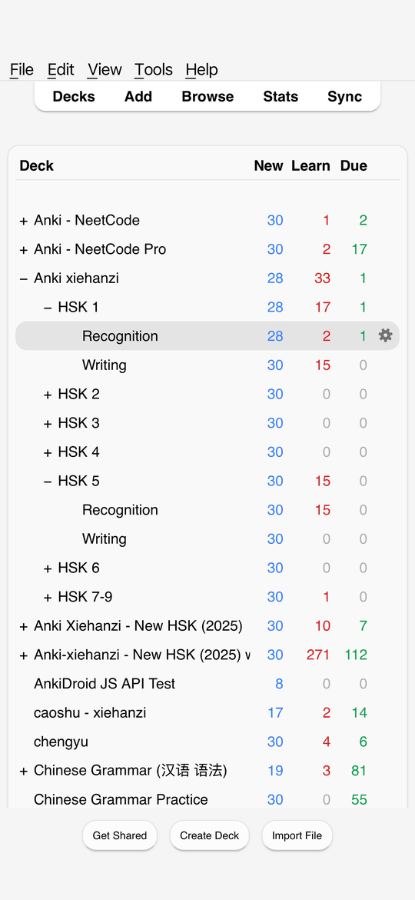
  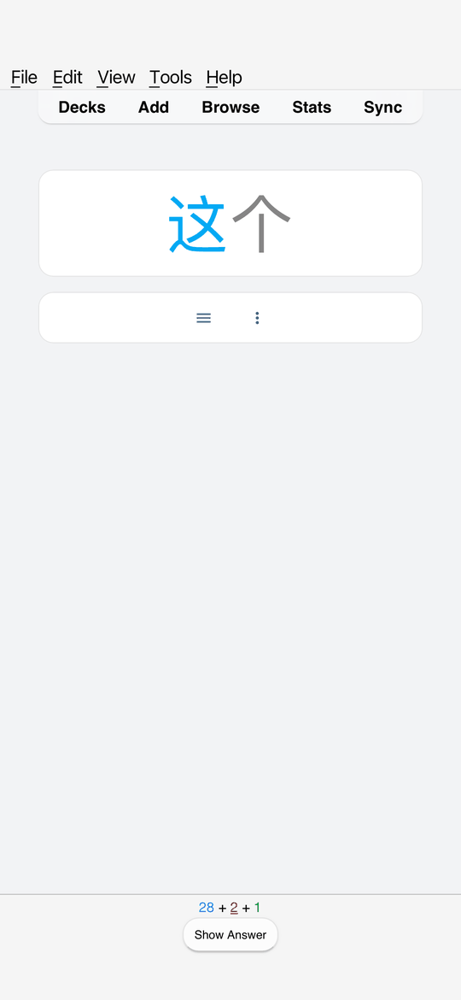
  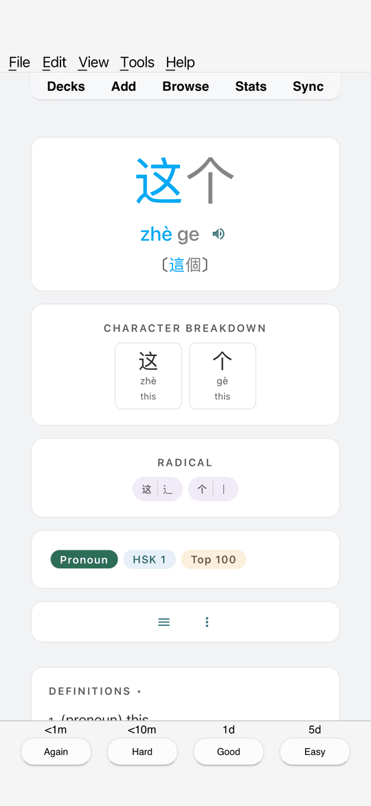
  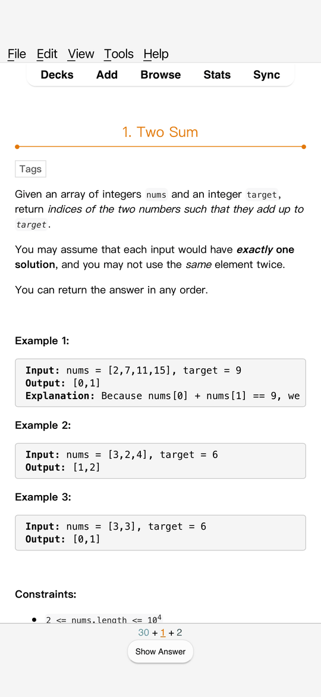
  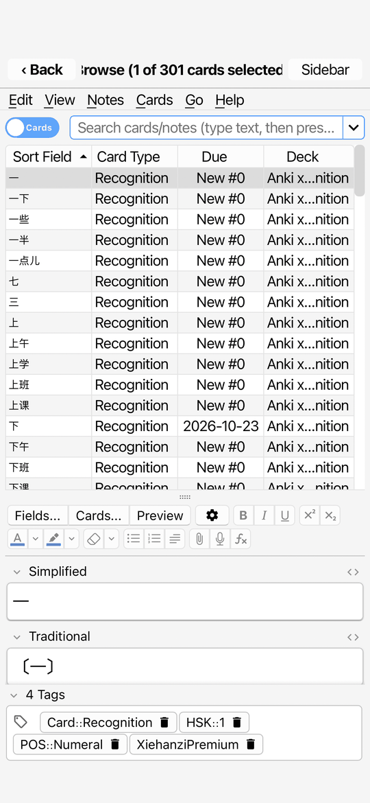
  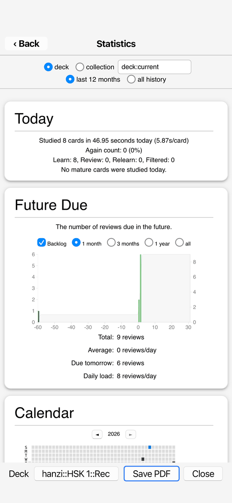
  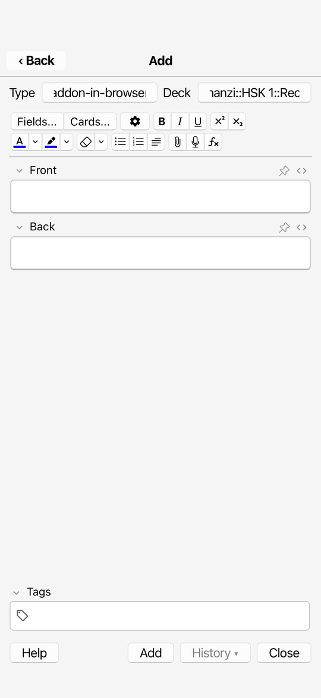

Downloads for every variant are on the [releases page](https://github.com/krmanik/kioku/releases/latest).
